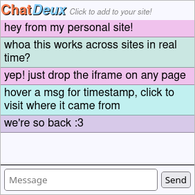

<h1></h1>

**ChatDeux** is an embeddable, real-time cross-site chat widget designed for quick, informal chats between websites, using an iframe backed by WebSockets. Up to 50 messages are kept in rolling history (anything past 50 is permanently pruned), every message links back to the site it was sent from, and each sender gets a consistent pseudonymous color.

<p>
  
</p>

Drop it onto your own site with an iframe (minimum recommended size `250px×250px`):

```html
<iframe src="https://chatdeux.calico.here/" id="deuxchatframe" width="250px" height="250px" frameborder="0">ChatDeux Frame</iframe>
```

Read more about the story and how it works here: **[chatdeux.calico.here/about](https://chatdeux.calico.here/about/)**

## Repository layout

- [`assets/`](assets) — Project logo and README preview image
- [`frontend/`](frontend) — Static embeddable chat widget (`index.html`, `style.css`) and info page (`about/`)
- [`backend/`](backend) — Node.js Express + `ws` server (`server.js`), tests (`server.test.js`), and dependencies (`package.json`)

## Features

- Real-time message broadcast over WebSockets with automatic reconnect and heartbeat cleanup.
- Rolling history capped at 50 messages (older messages are pruned and broadcast via `messages_pruned`).
- Pseudonymous per-sender colors derived from a salted SHA-256 `senderTag`.
- Per-IP sliding-window rate limiting for messages and webhooks.
- Optional JSON disk persistence (`messages.json`), admin clear endpoint, and authenticated inbound webhook endpoint.

## Running locally

### Backend

```sh
cd backend
npm install
npm test
npm start
```

### Configuration (environment variables)

| Variable | Default | Description |
| --- | --- | --- |
| `HOST` | `127.0.0.1` | Bind address |
| `PORT` | `3000` | Listening port |
| `TRUST_PROXY` | `loopback` | Express `trust proxy` setting (`true`, `false`, hop count, or `loopback`/`linklocal`/`uniquelocal`) |
| `MESSAGE_STORE_PATH` | `./messages.json` | Path for persisted message history |
| `DISABLE_MESSAGE_PERSISTENCE` | *(unset)* | Set to `1` to keep messages in memory only |
| `SENDER_HASH_SALT` | *(dev fallback)* | Salt used to derive pseudonymous `senderTag` values (set in production) |
| `ADMIN_TOKEN` | *(disabled)* | Bearer / `x-admin-token` secret enabling `DELETE /messages` |
| `WEBHOOK_SECRET` | *(disabled)* | Bearer / `x-webhook-secret` secret enabling `POST /webhook/message` |
| `MESSAGE_RATE_LIMIT_WINDOW_MS` | `60000` | Rate limit window for `POST /messages` (ms) |
| `MESSAGE_RATE_LIMIT_MAX` | `20` | Max messages per IP per window |
| `WEBHOOK_RATE_LIMIT_WINDOW_MS` | `60000` | Rate limit window for `POST /webhook/message` (ms) |
| `WEBHOOK_RATE_LIMIT_MAX` | `60` | Max webhook calls per IP per window |

### Frontend

Serve `frontend/` behind the same origin (e.g. `https://chatdeux.calico.here/`) with the backend reverse-proxied at `/api` (HTTP) and `/ws` (WebSocket).

## API endpoints

- `GET /messages` — Fetch up to the latest 50 messages
- `POST /messages` — Post a new message (`{ content, sourceUrl, sourceSite?, clientId? }`)
- `DELETE /messages` — Clear all messages (requires `ADMIN_TOKEN`)
- `POST /webhook/message` — Ingest an external message (requires `WEBHOOK_SECRET`)
- `GET /health` — Service health and active client/message counts

## License

MIT
